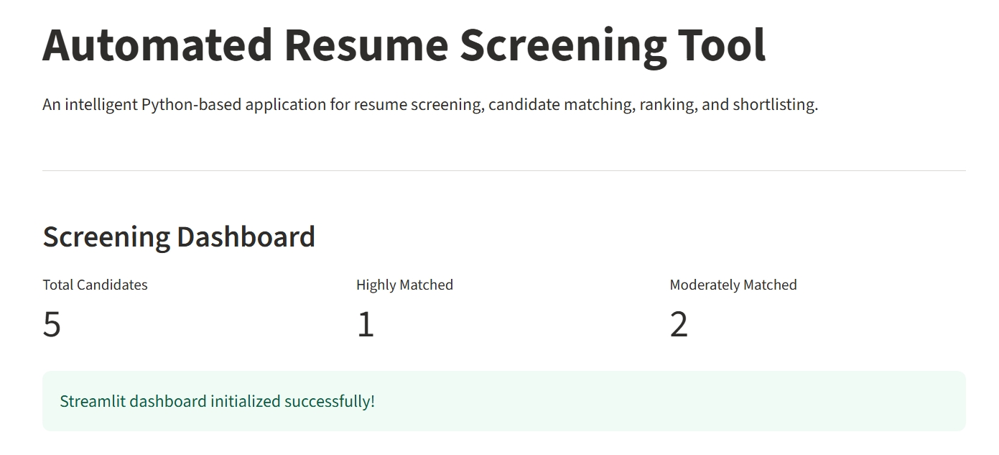
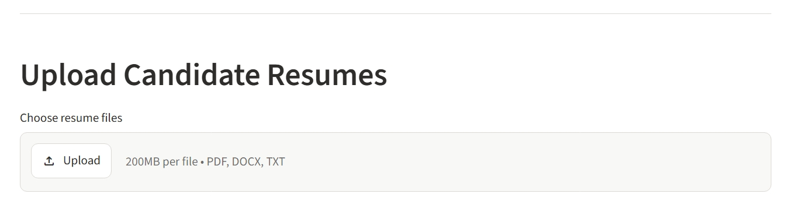
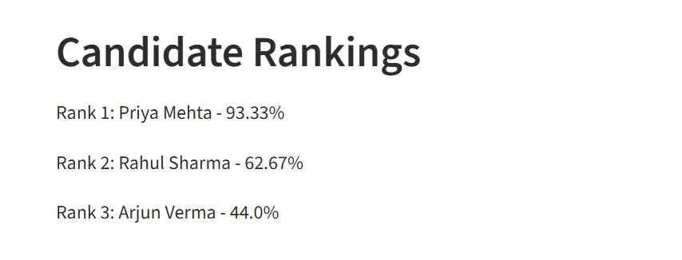
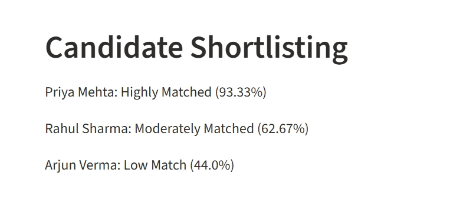

# AI-Powered Automated Resume Screening & Intelligent Recruitment Analytics System

## Project Overview

An AI-enabled, industry-oriented recruitment decision-support system developed using Python, Natural Language Processing (NLP), Sentence Transformers, RapidFuzz, SQLite, Streamlit, and Plotly.

The system automates resume processing, candidate information extraction, skill matching, semantic similarity analysis, candidate ranking, and recruitment analytics.

It demonstrates how Artificial Intelligence and automation can assist recruiters in reducing repetitive manual screening tasks while maintaining human oversight.

## Project Classification

- AI-Enabled Application
- Industry-Oriented Python Project
- HR Technology and Recruitment Automation
- Natural Language Processing
- Explainable AI
- Intelligent Recruitment Analytics
- Educational and Professional Portfolio Prototype

## Business Problem

Recruiters frequently receive large numbers of resumes for individual job openings.

Manual resume screening can be time-consuming, inconsistent, and difficult to scale.

This project demonstrates an intelligent screening workflow that helps organize candidate information, identify relevant skills, compare job requirements, and generate explainable screening results.

## Key Features

### Intelligent Resume Processing

- PDF resume ingestion
- DOCX resume ingestion
- TXT resume ingestion
- JSON resume ingestion
- Synthetic LinkedIn-style JSON profile ingestion
- Automatic file format detection
- Batch resume processing
- Structured candidate information extraction
- Missing-email candidate support

### Artificial Intelligence and NLP

- spaCy Natural Language Processing
- Named Entity Recognition
- Hybrid regex and NLP extraction
- Technical skills dictionary
- RapidFuzz skill correction suggestions
- Sentence Transformer embeddings
- all-MiniLM-L6-v2 pretrained AI model
- 384-dimensional semantic embeddings
- Cosine similarity analysis
- Certification extraction
- Professional summary extraction
- Experience extraction

### Intelligent Screening

- Required skills matching
- Preferred skills matching
- Experience-based matching
- Weighted candidate scoring
- Candidate ranking
- Semantic similarity analysis
- Missing skills identification
- Explainable screening evidence
- Human-in-the-loop verification

### Database Management

- SQLite relational database
- Candidate information storage
- Resume information storage
- Job description storage
- AI feature persistence
- Email-based duplicate prevention
- SHA-256 fingerprinting for identical profiles without email
- Foreign key enforcement
- Transaction management
- Database integrity validation

### Interactive Recruitment Dashboard

- Streamlit recruiter dashboard
- Multiple resume uploads
- Job description selection
- Candidate screening results
- Interactive Plotly visualizations
- Semantic similarity analytics
- Candidate ranking
- Explainable AI insights
- CSV report downloads
- JSON report downloads

## Technology Stack

| Technology | Purpose |
|---|---|
| Python 3.11 | Core application development |
| Streamlit | Interactive dashboard |
| spaCy | Natural Language Processing |
| Sentence Transformers | Semantic embeddings |
| all-MiniLM-L6-v2 | Pretrained AI model |
| RapidFuzz | Fuzzy skill matching |
| Scikit-learn | Similarity calculations |
| PyTorch | AI model execution |
| Transformers | Pretrained model infrastructure |
| SQLite | Relational database |
| Plotly | Interactive analytics |
| Pandas | Data processing |
| NumPy | Numerical computation |
| pdfplumber | PDF extraction |
| python-docx | DOCX extraction |
| Pytest | Automated software testing |
| Git and GitHub | Version control |

## System Architecture

```text
Resume Upload
      |
      v
Multi-Format Resume Parser
      |
      v
Hybrid NLP Extraction Engine
      |
      +--> Technical Skill Extraction
      +--> Named Entity Recognition
      +--> Certification Extraction
      +--> Fuzzy Skill Suggestions
      |
      v
Structured Candidate Information
      |
      v
AI Feature Engineering
      |
      +--> Sentence Transformer Embeddings
      +--> Semantic Similarity
      +--> Rule-Based Matching
      |
      v
Candidate Scoring and Ranking
      |
      v
SQLite Database
      |
      v
Streamlit Recruitment Dashboard
      |
      +--> Plotly Analytics
      +--> Explainable AI Evidence
      +--> CSV and JSON Reports
      |
      v
Human Recruiter Review
```

## Candidate Matching Method

The rule-based screening score uses the following components:

| Criteria | Weight |
|---|---:|
| Required Skills | 60% |
| Preferred Skills | 20% |
| Experience | 20% |
| Total | 100% |

Semantic similarity is calculated separately using Sentence Transformer embeddings and cosine similarity.

Fuzzy skill suggestions are presented as unverified corrections and require human review.

The screening scores are demonstration heuristics and do not represent objective measures of candidate suitability.

## AI Model

Model: all-MiniLM-L6-v2

Framework: Sentence Transformers

Embedding dimensions: 384

Similarity method: Cosine Similarity

The model converts skill-related text into numerical embeddings to support semantic comparison between candidate skills and job requirements.

## Automated Testing and Validation

The latest local regression testing results were:

| Validation | Result |
|---|---|
| Automated tests | 45 |
| Passed tests | 45 |
| Failed tests | 0 |
| Test pass rate | 100% |
| Resume files ingested | 21 |
| Unique synthetic candidates | 6 |
| Supported file formats | 4 |
| Hybrid NLP validation checks | 20 |

Additional manual validation confirmed fuzzy matching suggestions for Pandass, Numppy, and Kubernets.

These results demonstrate functionality on the project's synthetic test data. They do not establish real-world hiring accuracy.

## Installation

### 1. Clone the repository

```powershell
git clone -b advanced-ai-upgrade https://github.com/anupampeternetto-alt/Automated-Resume-Screening-Tool.git

cd Automated-Resume-Screening-Tool
```

### 2. Create a Python virtual environment

Python 3.11 is recommended.

```powershell
py -3.11 -m venv .venv311
```

### 3. Install project dependencies

```powershell
.\.venv311\Scripts\python.exe -m pip install --upgrade pip

.\.venv311\Scripts\python.exe -m pip install -r requirements.txt
```

### 4. Install the spaCy language model

```powershell
.\.venv311\Scripts\python.exe -m spacy download en_core_web_sm
```

### 5. Initialize the database

```powershell
.\.venv311\Scripts\python.exe -m src.database
```

An internet connection may be required during the first execution to download the pretrained Sentence Transformer model.

## Running the Application

### Streamlit Dashboard

```powershell
.\.venv311\Scripts\python.exe -m streamlit run app.py
```

The dashboard normally opens at:

http://localhost:8501

Upload sample resumes, select job requirements, and review the screening results and analytics.

### Command-Line Application

```powershell
.\.venv311\Scripts\python.exe main.py
```

### Run Automated Tests

```powershell
.\.venv311\Scripts\python.exe -m pytest -q
```

Latest verified result:

```text
45 passed
```

## Application Screenshots

### Screening Dashboard



### Resume Upload



### Candidate Rankings



### Candidate Shortlisting



## Responsible AI and Human Oversight

This application is designed as a recruitment decision-support prototype, not an autonomous hiring system.

- Human review is required before recruitment decisions.
- Fuzzy matching suggestions require verification.
- Semantic similarity does not establish actual qualifications.
- Missing information should not automatically disqualify candidates.
- Synthetic candidate data is used for demonstration.
- Screening results should not be treated as final hiring decisions.

## Project Limitations

- Resume formatting can affect extraction accuracy.
- NLP models can incorrectly classify entities.
- Scanned image-based resumes may require OCR.
- Fuzzy matching can produce incorrect suggestions.
- Profile fingerprinting identifies identical extracted text rather than real-world candidate identity.
- Semantic similarity is separate from the current weighted ranking score.
- Formal fairness and real-world recruitment accuracy have not been established.
- Clean-environment installation requires further validation.
- This project is not a production-ready enterprise recruitment platform.

## Future Enhancements

- FastAPI REST API
- Next.js and Tailwind CSS frontend
- Combined semantic and rule-based ranking
- Advanced LinkedIn PDF profile extraction
- Improved named entity recognition
- ROC-AUC and PR-AUC evaluation
- Top-K ranking evaluation
- Docker containerization
- Candidate consent and data deletion workflows
- Formal fairness and bias evaluation
- Cloud deployment
- Recruiter feedback integration

## Industry Applications

- HR Technology
- Recruitment Automation
- Talent Acquisition Support
- Resume Screening
- Intelligent Document Processing
- AI-Assisted Candidate Matching
- Recruitment Analytics

## Skills Demonstrated

- Python Development
- Artificial Intelligence Integration
- Natural Language Processing
- Semantic Search and Similarity
- Data Processing
- Feature Engineering
- Database Management
- Software Automation
- Interactive Dashboard Development
- Explainable AI
- Automated Software Testing
- Git and GitHub Version Control

## Project Objective

This project serves as practical proof of work demonstrating the application of Python, Artificial Intelligence, NLP, automation, database management, analytics, and software testing to a real-world business problem.

It is intended as an industry-oriented portfolio project for opportunities in Python development, AI and NLP, data analytics, automation, and HR technology.

## Author

Anupam Peter Netto

AI-Enabled Industry-Oriented Python Portfolio Project

## License

No open-source license has been selected.
